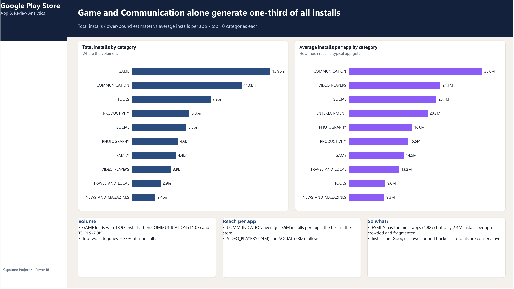
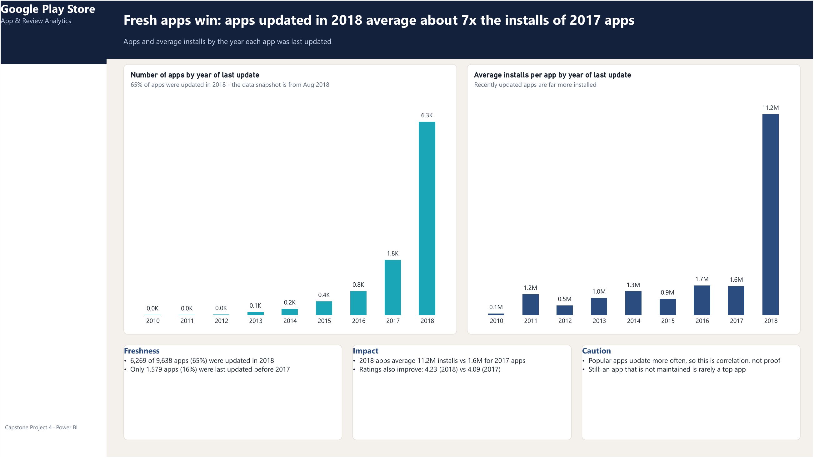
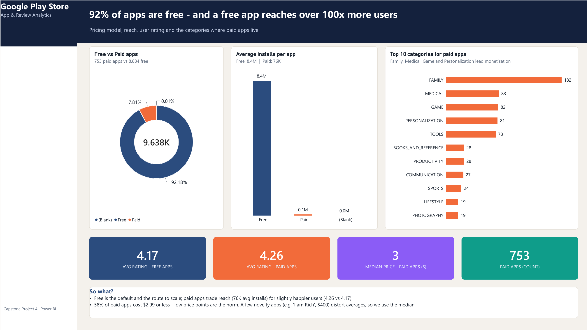
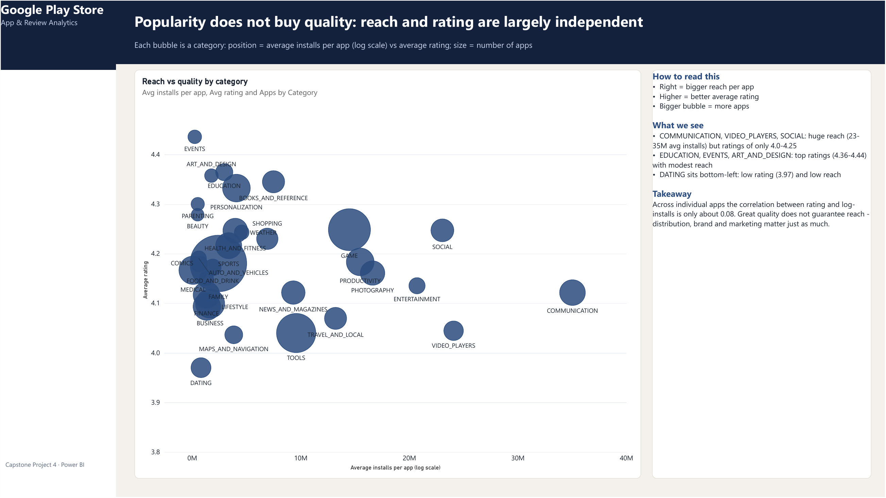
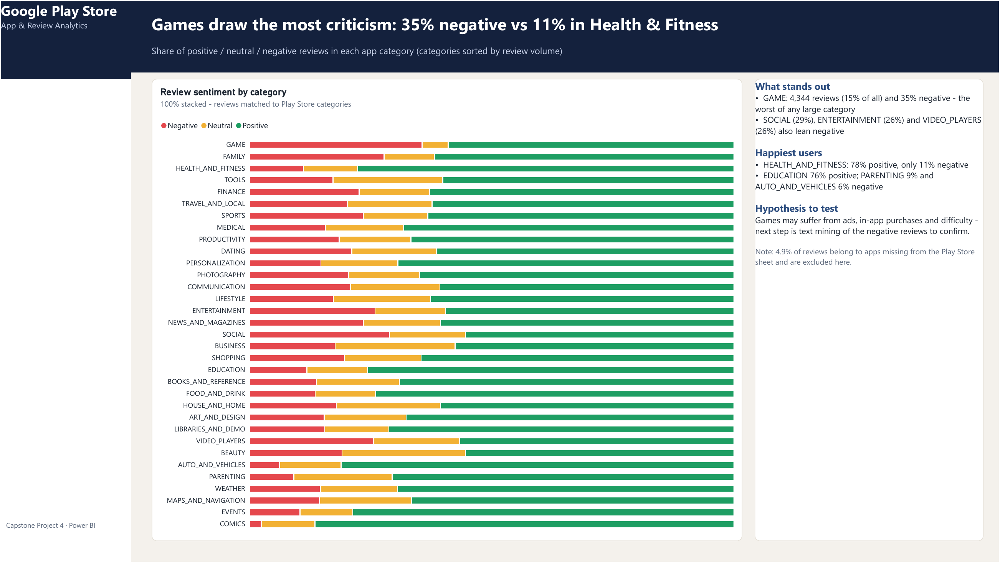
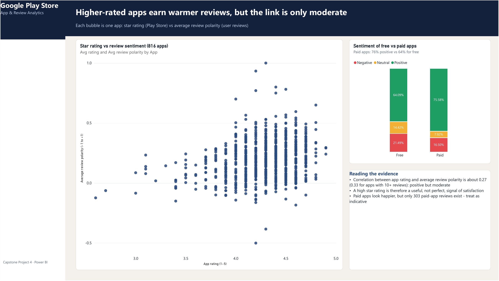

# Google Play Store: App Market & User Sentiment Analysis

### Interactive 13-Page Power BI Dashboard

**Author:** Nikhil Sharma  
**Project:** Capstone Project 4  
**Tools:** Power BI Desktop, Microsoft Excel, Power Query, DAX

---

## 1. Project Overview

This project analyzes Google Play Store application data and user reviews to identify patterns in app popularity, ratings, pricing, installations, and customer sentiment.

Using Power BI, Excel, Power Query, and DAX, I developed an interactive 13-page dashboard to transform application data into meaningful business insights.

The analysis is designed to support data-driven decision-making for app developers, product managers, and marketing teams.

---

## 2. Project Objectives

The main objectives of this project are:

- Analyze app installations and identify popular categories.
- Evaluate application ratings and overall app quality.
- Compare free and paid applications.
- Understand the relationship between app ratings and installations.
- Analyze app update freshness and performance.
- Examine positive, neutral, and negative user sentiment.
- Compare star ratings with written review sentiment.
- Generate actionable business recommendations using Power BI.

---

## 3. Project Highlights

| Metric | Value |
|---|---|
| Total Unique Apps | 9,638 |
| App Categories | 33 |
| User Reviews | 29,692 |
| Apps with Reviews | 865 |
| Dashboard Pages | 13 |

---

## 4. Tools & Technologies

| Tool | Purpose |
|---|---|
| Power BI Desktop | Dashboard development and visualization |
| Microsoft Excel | Dataset preparation |
| Power Query | Data cleaning and transformation |
| DAX | KPI calculations and analytical measures |

---

## 5. Business Questions

This project addresses five important business questions:

1. Which app categories dominate in app count and installations?
2. Does a higher app rating lead to more installations?
3. How do free and paid applications differ in reach, ratings, and pricing?
4. Which categories receive the most positive and negative user feedback?
5. Do star ratings accurately reflect customer sentiment in written reviews?

---

## 6. Dataset Description

**Dataset:** Google Play Store Apps and User Reviews

**Source workbook:**  
`Capstone_Project_4_Play_Store_and_User_Reviews_Cleaned.xlsx`

### Dataset 1: Google Play Store Apps

- Original Records: 9,659
- Unique Apps: 9,638
- Total Columns: 13
- App Categories: 33

**Important Columns:**

- App
- Category
- Rating
- Reviews
- Size
- Installs
- Type
- Price
- Content Rating
- Genres
- Last Updated
- Current Version
- Android Version

### Dataset 2: User Reviews

- Total Reviews: 29,692
- Apps with Reviews: 865
- Total Columns: 5

**Important Columns:**

- App
- Translated Review
- Sentiment
- Sentiment Polarity
- Sentiment Subjectivity

---

## 7. Data Cleaning & Preparation

Data cleaning and transformation were performed using Excel and Power Query.

### Key Steps

1. Removed duplicate application records.
2. Created a standardized AppKey using uppercase and trimmed application names.
3. Preserved missing rating values instead of replacing them with zero.
4. Established a many-to-one relationship between the app and review tables using AppKey.
5. Excluded unmatched reviews from category-level analysis.
6. Treated installation figures as lower-bound estimates rather than exact counts.
7. Created DAX measures to calculate dashboard KPIs.

---

## 8. Power BI Dashboard Overview

The project includes 13 interactive dashboard pages with KPI cards, navigation, slicers, and visualizations.

| Page | Dashboard Section |
|---|---|
| 1 | Cover |
| 2 | Executive Summary |
| 3 | Category Landscape |
| 4 | Installs & Reach |
| 5 | Update Freshness |
| 6 | App Quality |
| 7 | Free vs Paid |
| 8 | Quality vs Reach |
| 9 | Review Sentiment |
| 10 | Most-Reviewed Apps |
| 11 | Sentiment by Category |
| 12 | Ratings vs Sentiment |
| 13 | Conclusions |

---

## 9. Dashboard Preview

The following screenshots demonstrate six important analytical sections of the Power BI dashboard.

### 9.1 Installs and Reach

**Business Insight:**

Game and Communication categories generate approximately one-third of total installations.

Communication also leads in average installations per app.

### 9.2 Update Freshness

**Business Insight:**

Applications updated more recently show higher average installation figures in this dataset.

This relationship does not establish that updates directly cause higher installations.

### 9.3 Free vs Paid Applications

**Business Insight:**

Free applications dominate the Google Play Store and generate substantially higher average installations.

Paid applications have a slightly higher average star rating.

### 9.4 Quality vs Reach

**Business Insight:**

App ratings have a weak correlation with installation figures.

A high rating does not necessarily guarantee high popularity.

### 9.5 Sentiment by Category

**Business Insight:**

User sentiment differs across application categories.

Game applications have a relatively high negative review share, while Health & Fitness receives a high proportion of positive reviews.

### 9.6 Ratings vs Sentiment

**Business Insight:**

Higher-rated applications generally receive warmer user feedback, but the relationship is moderate.

Star ratings and written reviews provide complementary perspectives on customer satisfaction.

---

## 10. Key Business Insights

### A. App Market Analysis

- Family, Game, and Tools account for approximately 37% of applications.
- Game generates approximately 13.9 billion installations.
- Communication generates approximately 11 billion installations.
- Communication leads in average installations per app at approximately 35 million.

### B. App Quality and Pricing

- Average App Rating: 4.17 stars
- Apps Rated 4.0 or Higher: 77% of rated apps
- Free Applications: Approximately 92%
- Average Free App Installs: 8.4 million
- Average Paid App Installs: 76,000
- Average Paid App Rating: 4.26
- Average Free App Rating: 4.17
- Median Paid App Price: $2.99

### C. Update Freshness

Applications last updated in 2018 averaged approximately 11.2 million installations.

Applications last updated in 2017 averaged approximately 1.6 million installations.

This indicates an association between update freshness and application reach.

### D. User Sentiment Analysis

The analysis includes 29,692 user reviews.

| Sentiment | Percentage |
|---|---|
| Positive | 64% |
| Neutral | 15% |
| Negative | 21% |

**Additional Findings:**

- Games: 35% negative reviews.
- Health & Fitness: 78% positive reviews.
- Angry Birds Classic: 55% negative reviews.
- ColorNote Notepad: 92% positive reviews.

### E. Ratings vs Sentiment

**Correlation Analysis:**

- App Installs vs Ratings: Approximately 0.08
- Star Ratings vs Review Sentiment Polarity: Approximately 0.27

These results suggest that app popularity, star ratings, and written customer feedback measure different aspects of application performance.

---

## 11. Business Recommendations

### For App Developers

- Evaluate category competition before launching applications.
- Consider free pricing strategies to improve reach.
- Analyze customer willingness to pay before setting paid-app prices.

### For Product Managers

- Monitor application updates regularly.
- Track negative customer feedback.
- Improve app functionality based on user reviews.

### For Marketing Teams

- Do not rely exclusively on app ratings to estimate popularity.
- Develop effective branding and distribution strategies.
- Use category-level insights to identify market opportunities.

### For Game Developers

- Investigate negative review themes.
- Evaluate complaints about advertisements and in-app purchases.
- Improve the user experience based on customer feedback.

---

## 12. Project Files

The repository contains the following project files:

### Power BI Dashboard

`Nikhil_4th_Capston_Project_Presentation.pbix`

Contains the interactive 13-page Power BI dashboard.

### Project Documentation

`Nikhil_Sharma_Capstone4_PlayStore_Dashboard_Report.docx`

Contains the detailed project report and analysis.

### Dashboard Screenshots

Six PNG files representing important dashboard visualizations.

**Note:** Download the PBIX file and open it using Power BI Desktop to explore the interactive dashboard.

---

## 13. Project Limitations

- Installation figures represent lower-bound estimates rather than exact installation counts.
- Only 865 applications have associated user reviews.
- Approximately 15% of applications have missing ratings.
- Sentiment scores are model-generated.
- The dataset represents a snapshot up to August 2018 and does not reflect current market conditions.

---

## 14. Future Improvements

- Perform text mining on user review content.
- Develop predictive models for application installations and ratings.
- Introduce additional category slicers and drill-through analysis.
- Refresh the dashboard using more recent Google Play Store datasets.
- Expand sentiment analysis using advanced natural language processing techniques.

---

## 15. Conclusion

This project transforms Google Play Store application data and user reviews into actionable business insights.

By combining app performance, pricing, ratings, installations, and customer sentiment analysis, the dashboard helps identify market opportunities, understand user satisfaction, and support data-driven business decisions.

The project demonstrates practical skills in Power BI dashboard development, data cleaning, data modeling, DAX, visualization, and business analytics.

---

**Developed by Nikhil Sharma**  
*Power BI Capstone Project 4*

## Dashboard Preview

### 1. Installs and Reach

### 2. Update Freshness

### 3. Free vs Paid

### 4. Quality vs Reach

### 5. Sentiment by Category

### 6. Ratings vs Sentiment

